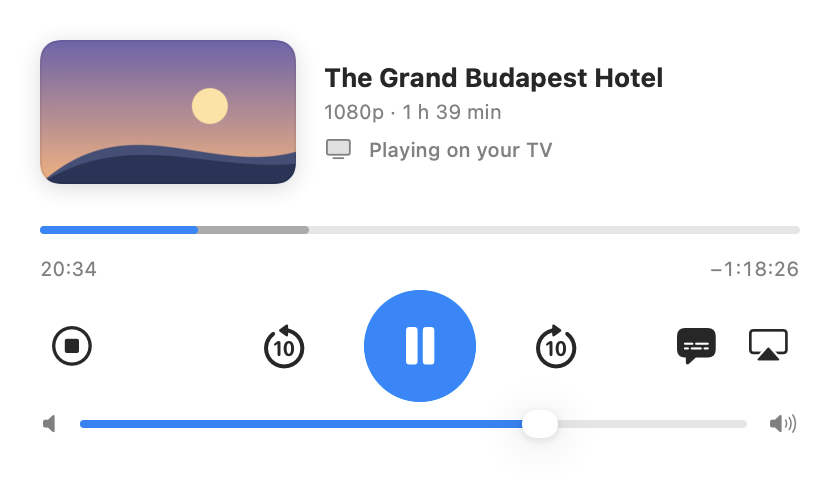
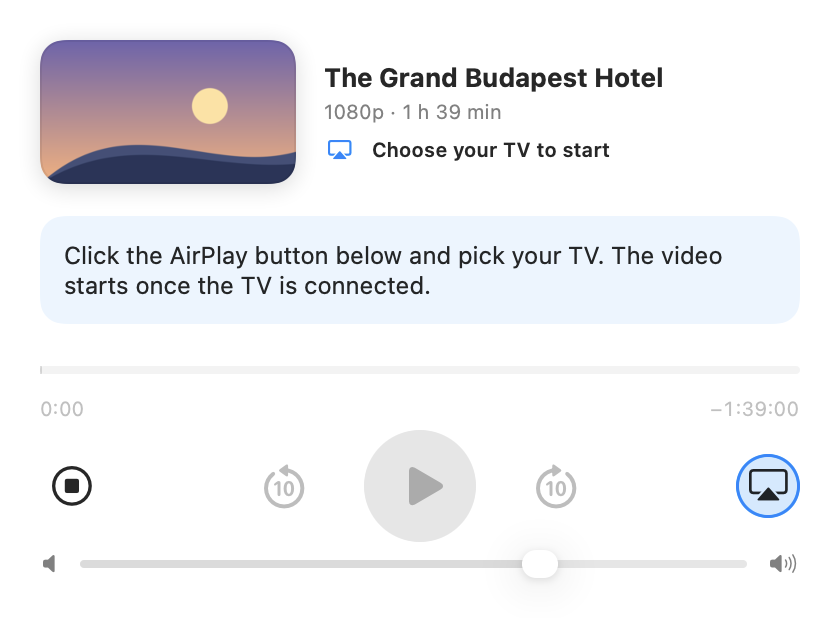
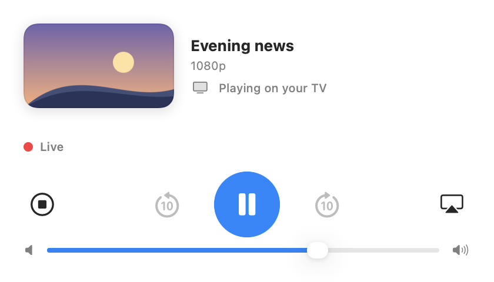
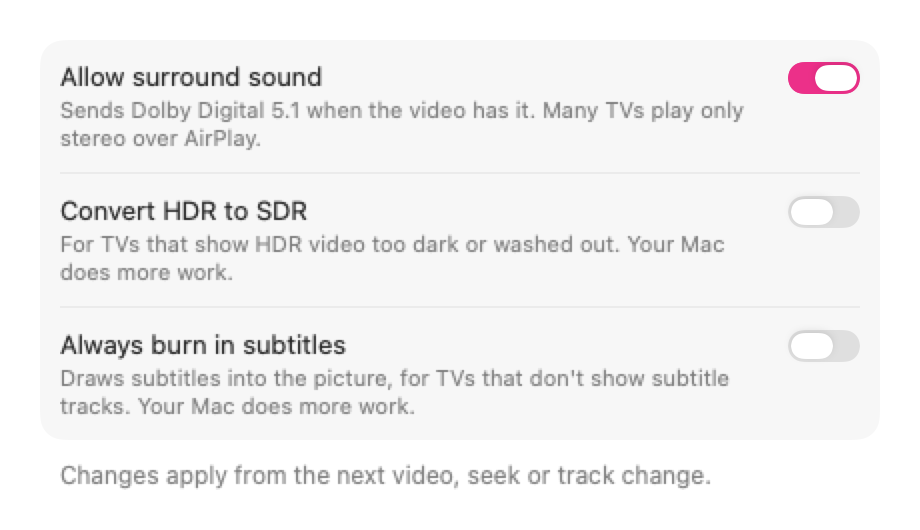

<a id="readme-top"></a>

<div align="center">


</div>

<h1 align="center">Paper Plane</h1>

<div align="center">


**Throw any video at your TV.**

MKVs, whatever's playing in Chrome or Brave, YouTube, a link you copied. If your TV has AirPlay, Paper Plane gets it there.

</div>

<p align="center">
  <picture>
    <source media="(prefers-color-scheme: dark)" srcset="docs/design/remote-tracks-dark.png">
    
  </picture>
</p>

## Table of Contents

- [About](#about)
- [Install](#install)
- [Features](#features)
- [How it works](#how-it-works)
- [Privacy](#privacy)
- [Requirements](#requirements)
- [Building from source](#building-from-source)
- [Contributing](#contributing)
- [License](#license)

## About

Plenty of TVs have AirPlay built in now. macOS will mirror your screen to one, and QuickTime and Safari can send some videos, but an MKV, a film with a DTS soundtrack or the video playing in Chrome won't go.

Paper Plane sends them anyway. It works out what your TV can't play, converts only that part with ffmpeg while the video plays, and streams it from your Mac using macOS's own AirPlay. Video that's already H.264 or HEVC is copied rather than re-encoded, so it starts in a couple of seconds and looks exactly like the file. Web video comes the same way, whether the site streams it as HLS or DASH.

If you've used Beamer, it's the same idea, free and open source.

<p align="right"><a href="#readme-top">Back to top ⬆️</a></p>

## Install

Download `Paper-Plane-<version>.dmg` from the [Releases page](https://github.com/RohanG9929/paper-plane/releases), open it and drag Paper Plane to Applications. Each release also has the extension as a zip and a `SHA256SUMS` file to check the downloads against. Or [build it yourself](#building-from-source).

Releases aren't signed with an Apple Developer ID yet, so the first time you open Paper Plane, macOS will say it can't check it: right-click (or Control-click) the app in Applications and choose Open, or go to System Settings → Privacy & Security and click Open Anyway. The first time you play a video, allow Paper Plane to find devices on your local network.

### The browser extension

For videos playing in Chrome or Brave:

1. Unzip `Paper-Plane-Extension-<version>.zip` from the release, or build it: `cd extension && npm ci --ignore-scripts && npm run build` (it lands in `extension/dist`).
2. Open `chrome://extensions`, turn on Developer mode, click Load unpacked and choose `extension/dist`.
3. Open Paper Plane once, so the browser can reach it.

<p align="right"><a href="#readme-top">Back to top ⬆️</a></p>

## Features

### Drop a video, pick your TV

Click the paper plane in the menu bar and drag a video into the panel that drops down, then pick your TV with the AirPlay button. Click the plane again (or press Esc) to put the panel away; right-click it for Settings and the rest. Finder's Open With → Paper Plane works too. Anything ffmpeg can read plays: MKV, MP4, WebM, AVI and the rest.

Paper Plane copies what your TV can play and converts the rest. DTS and TrueHD soundtracks become audio the TV understands, VP9 and AV1 are re-encoded on the Mac's hardware encoder, and HDR stays HDR.

<p align="center">
  <picture>
    <source media="(prefers-color-scheme: dark)" srcset="docs/design/remote-choosing-tv-dark.png">
    
  </picture>
</p>

### Jump anywhere

Seek anywhere in the film, even past what's been converted so far. Paper Plane starts again from there, which takes a few seconds. Media keys and the Now Playing controls work too.

Your Mac stays awake while the TV plays. Closing a laptop's lid still puts it to sleep and stops the video.

### Audio tracks and subtitles

The speech-bubble button switches the audio track and the subtitles, including subtitles inside the file and `Movie.srt` or `Movie.en.srt` files next to it. Blu-ray and DVD subtitles are drawn into the picture.

### Videos from Chrome and Brave

Play a video on a site and click the paper plane in the toolbar. It's grey until it finds a video. When it's sure which one you're watching, a click sends it; when it isn't, it shows a count and lets you choose. Paper Plane starts where the browser was, and the browser's video pauses. Live streams play live. HLS, DASH and plain video files all play. A site with several qualities plays at up to 1080p, in a form the TV takes without converting when there is one.

If the button stays grey, click it anyway. Its popup offers to try the page: Paper Plane asks yt-dlp for the video, on any site, not only YouTube. If yt-dlp can't find one, the remote says so. A page tried this way doesn't carry the browser's login, so a video that needs you signed in won't come this way (YouTube is the exception).

Some streams are locked on purpose. Video protected by DRM or a similar scheme still can't play, and when Paper Plane can tell, it says "This video is protected" instead of sending the TV noise.

<p align="center">
  <picture>
    <source media="(prefers-color-scheme: dark)" srcset="docs/design/remote-live-dark.png">
    
  </picture>
</p>

### YouTube and copied links

Copy a link to a video on YouTube or most other video sites, then choose Play Copied Link from the menu bar or under the remote's drop zone, or press ⌘V in the remote. A link dragged from the browser's address bar onto the remote or the menu bar icon plays too. On YouTube from the extension, Paper Plane gets the video signed in as you are in the browser. A copied link carries no cookie, so a video that needs you signed in may not play from one.

Paper Plane finds the video on a page with [yt-dlp](https://github.com/yt-dlp/yt-dlp). It ships a copy and keeps it up to date. Recent versions of yt-dlp need a JavaScript runtime for YouTube, so if YouTube videos fail or play at low quality, install Deno: `brew install deno`.

### Made to fit your TV

Paper Plane was tested on a Sony XBR-55X950G, which won't take Dolby surround over AirPlay, so surround soundtracks become stereo by default. Settings has three switches for TVs that differ: surround sound, HDR to SDR, and drawing subtitles into the picture. DASH playback, the toolbar's Try this page and streams that need an `Authorization` header came after that test; their rows in [docs/sony-test-results.md](docs/sony-test-results.md) are still waiting to be run on the TV.

<p align="center">
  <picture>
    <source media="(prefers-color-scheme: dark)" srcset="docs/design/settings-dark.png">
    
  </picture>
</p>

If something goes wrong, Show Log reveals a log in `~/Library/Logs/Paper Plane/` that you can attach to a bug report.

<p align="right"><a href="#readme-top">Back to top ⬆️</a></p>

## How it works

Paper Plane reads the video's tracks with ffprobe and decides, track by track, what to copy and what to convert. ffmpeg then writes the result as HLS, a few seconds at a time, into a temporary folder. A small web server on your Mac's network address serves it behind a random token, and macOS's AirPlay hands that address to the TV, which fetches the video from your Mac directly. Only a window around where you're watching is kept on disk.

The full design is in [docs/superpowers/specs/2026-10-15-paper-plane-design.md](docs/superpowers/specs/2026-10-15-paper-plane-design.md), with later decisions in [docs/superpowers/specs/](docs/superpowers/specs/). What the Sony test found is in [docs/sony-test-results.md](docs/sony-test-results.md).

<p align="right"><a href="#readme-top">Back to top ⬆️</a></p>

## Privacy

Paper Plane has no accounts, no analytics and no servers of its own. It connects to three places: the site a video comes from, your TV, and GitHub, to update yt-dlp.

- The extension passes along the site's cookies for the video you send, and the `Authorization` header when the stream's request had one, as some self-hosted servers need. Paper Plane sends them only to the stream's own site, only to fetch that video, and never saves them. A stream whose pieces sit on another host doesn't get them there. YouTube's cookie reaches yt-dlp in memory, never on its command line or in a file.
- yt-dlp updates come from yt-dlp's GitHub releases, at most once a day and whenever a page fails, and each download is checked against the release's SHA-256 sums.
- Logs leave out cookies, passwords and your home folder's path.

<p align="right"><a href="#readme-top">Back to top ⬆️</a></p>

## Requirements

- macOS 14 Sonoma or later, on Apple silicon
- A TV or streaming box with AirPlay
- Chrome or Brave, for videos playing in the browser

<p align="right"><a href="#readme-top">Back to top ⬆️</a></p>

## Building from source

You need Xcode 26 or later and Homebrew.

```bash
brew install ffmpeg            # development and tests only
scripts/make-test-media.sh     # generates test clips into testdata/media/
scripts/test-core.sh           # runs the core and UI tests

brew install meson ninja autoconf automake libtool pkgconf
scripts/build-ffmpeg.sh        # builds the ffmpeg the app ships into vendor/ffmpeg/ (a few minutes)
scripts/check-ffmpeg.sh        # checks that build

open app/PaperPlane.xcodeproj  # the app; run the PaperPlane scheme
scripts/check-quit-cleanup.sh  # checks quitting never leaves ffmpeg or session files behind
scripts/check-bridge.sh        # sends requests through the browser helper to the app

cd extension && npm ci --ignore-scripts
npm test && npm run typecheck  # the extension's tests
npm run build && cd ..
scripts/check-extension.sh     # the extension in a headless Chrome with a throwaway profile, through to the app

scripts/fetch-yt-dlp.sh        # fetches the yt-dlp the app ships into vendor/yt-dlp/, checked against its release's sums
scripts/check-fetch-yt-dlp.sh  # checks that script against a stand-in release on this Mac
scripts/make-release.sh        # builds, checks and zips the app and the extension into build/release/
```

The app installs the browser helper's manifest for Chrome and Brave each time it starts, and checks for a newer yt-dlp once a day. Pass `-PaperPlaneInstallsBrowserHosts NO` and `-PaperPlaneUpdatesYtDlp NO` when launching it to leave the browsers' folders and GitHub alone; the check scripts do. A build without `vendor/yt-dlp/` fetches yt-dlp the first time a page needs it, and a development build uses Homebrew's (`brew install yt-dlp`) if there is one.

Debug builds made before `scripts/build-ffmpeg.sh` use Homebrew's ffmpeg. Release builds need the bundled one. The subtitle burn-in tests run only with the bundled ffmpeg, since Homebrew's has no libass:

```bash
PAPERPLANE_FFMPEG="$PWD/vendor/ffmpeg/bin/ffmpeg" PAPERPLANE_FFPROBE="$PWD/vendor/ffmpeg/bin/ffprobe" scripts/test-core.sh
```

<p align="right"><a href="#readme-top">Back to top ⬆️</a></p>

## Contributing

Paper Plane is a personal project, and help is welcome.

- 🐛 Found a bug or want a feature? Open an issue, and attach the log from Show Log if something broke.
- 🔧 Before a pull request, run `scripts/test-core.sh` and the extension's tests.
- ⭐ If it's useful to you, a star helps other people find it.

<p align="right"><a href="#readme-top">Back to top ⬆️</a></p>

## License

Paper Plane is licensed under the GNU General Public License v3.0. See [LICENSE](LICENSE) for details.

<p align="right"><a href="#readme-top">Back to top ⬆️</a></p>
